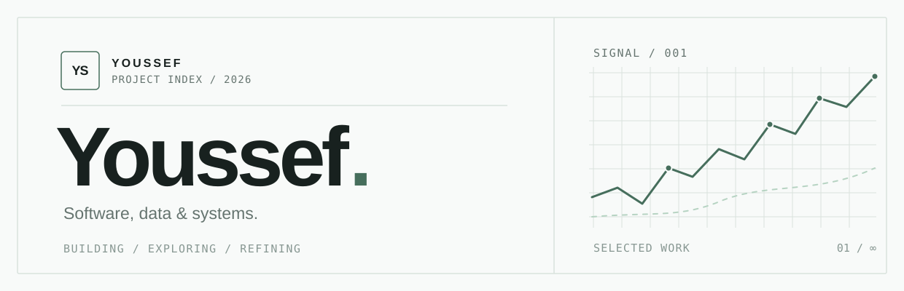
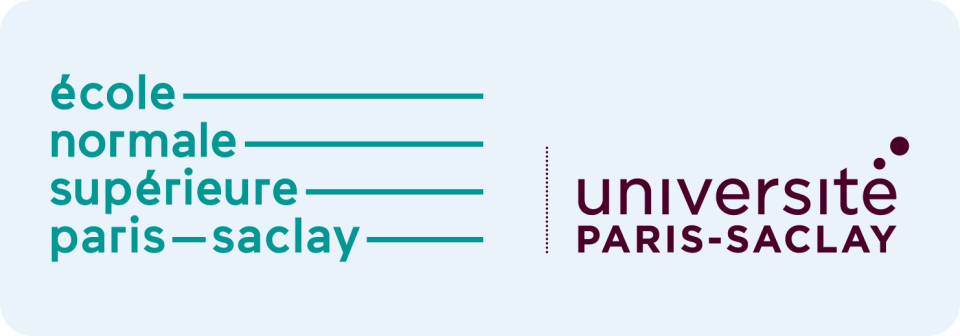
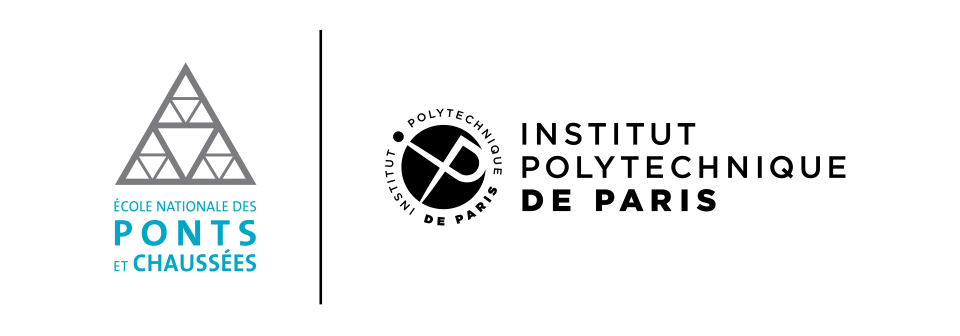
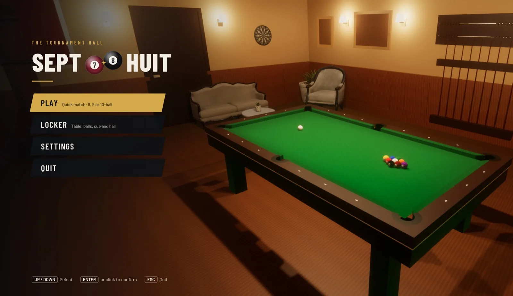
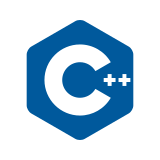
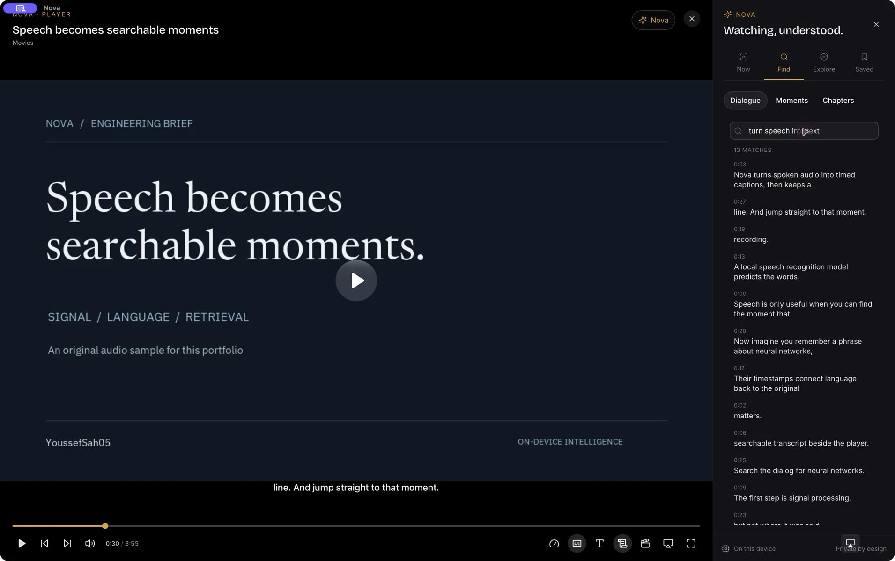
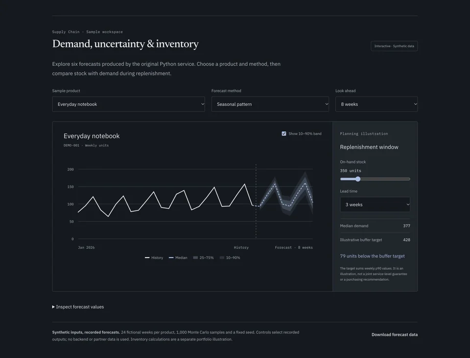
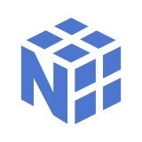
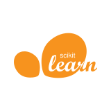

<a href="https://youssefsah05.vercel.app">
  <picture>
    <source media="(prefers-color-scheme: dark)" srcset="./assets/hero-dark.svg">
    <source media="(prefers-color-scheme: light)" srcset="./assets/hero-light.svg">
    
  </picture>
</a>

  
  
  
  

I study applied mathematics and machine learning, and build software to explore how models and systems behave. I'm an **MVA student at ENS Paris-Saclay** and an **engineering student at École des Ponts**, with a background in statistics, optimization and computer science. My open-source projects range from physics simulation to on-device speech search and demand forecasting.

  
  &nbsp;
  <picture>
    <source media="(prefers-color-scheme: dark)" srcset="./assets/schools/ecole-des-ponts-dark.png">
    
  </picture>

> **Seeking a 4–6 month research internship in machine learning, deep learning or NLP, starting April 2027.**
> [Get in touch →](mailto:youssef.sahraoui@enpc.fr)

## Featured projects

### [Septhuit](https://github.com/YoussefSah05/septhuit) · 3D pool, exact physics, trained opponents

A realism-first 3D pool game built from scratch in C++20 and OpenGL, without a game engine. Formerly *Billiards Saloon*.

- **Event-based physics:** sliding, rolling and spin are computed exactly between collisions, and regression-tested against pooltool golden shots.
- **Referee:** WPA rules for 8-, 9- and 10-ball, including breaks, fouls and full matches.
- **Opponents:** they search candidate shots with the same simulator. A 132,951-parameter relational Transformer value network, trained by league self-play, contributes to shot scoring. Its strength is comparable to classical search, not yet better.
- **CI:** builds and tests on macOS, Ubuntu and Windows.

<table>
<tr>
<td width="50%" valign="top">

### [Nova](https://youssefsah05.vercel.app/projects/nova/)

**Turn spoken media into searchable moments.**

A native macOS media player with on-device Whisper captions. Its hybrid dialogue search combines E5 embeddings and SQLite FTS5 using reciprocal rank fusion. A Rust core keeps credentials out of the React webview.

   

</td>
<td width="50%" valign="top">

### [Supply Chain Control Tower](https://github.com/YoussefSah05/supply-chain-project)

**From sales data to inventory decisions.**

A team-built forecasting and inventory app that grew from a Streamlit prototype into FastAPI and React. Holt smoothing and Monte Carlo sampling produce p10–p90 demand bands, and the codebase has 40 tests.

   

</td>
</tr>
</table>

Nova's preview is a native capture with original sample media. The Supply Chain forecasts use synthetic data, and their figures are illustrative.

## Research & coursework

| Project | Focus |
|---|---|
| **Optimization in interacting epidemic models** Research intern · CERMICS, École des Ponts · Jun–Aug 2026 | Vaccination allocations in a two-population SIS model, analysed through curvature and Pareto frontiers. |
| **[Performer attention for LLMs](https://github.com/YoussefSah05/Performer-attention-LLM)** M2 research project · with CERMICS and Advansight | A kernel approach to reduce the computational cost of attention layers in LLMs. |
| **[Quantum PDE simulation](https://github.com/YoussefSah05/quantum-pde-simulation)** Student project · Python | Simulating quantum PDEs with circuits and numerical methods, with a written report. |

## Toolbox

**Languages & tools:** Python · C++ · Rust · Linux · Git 
**ML & data:** PyTorch · NumPy · Pandas · scikit-learn · Hugging Face 
**Mathematics:** Statistics · Convex optimization · Stochastic processes · Machine learning

---

  <a href="https://youssefsah05.vercel.app"><b>youssefsah05.vercel.app</b></a> ·
  <a href="mailto:youssef.sahraoui@enpc.fr">Email</a> ·
  <a href="https://linkedin.com/in/youssef-sahraoui">LinkedIn</a> ·
  <a href="https://github.com/YoussefSah05?tab=repositories">All repositories</a>

