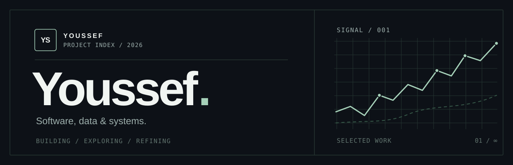
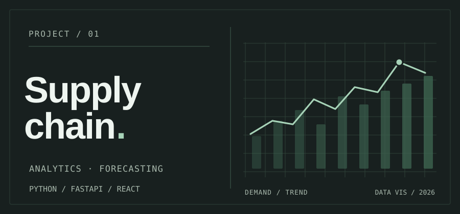

<picture>
  <source media="(prefers-color-scheme: dark)" srcset="./assets/hero-dark.svg">
  <source media="(prefers-color-scheme: light)" srcset="./assets/hero-light.svg">
  
</picture>

 

I build and explore practical software, with an interest in **data**, **analytical tools**, and **thoughtful interfaces**. This is an evolving selection of my projects — from early experiments to finished applications.

 

### 01 / Selected work

<table>
  <tr>
    <td width="54%" valign="top">
      <a href="https://github.com/YoussefSah05/supply-chain-project">
        <picture>
          <source media="(prefers-color-scheme: dark)" srcset="./assets/supply-chain-dark.svg">
          <source media="(prefers-color-scheme: light)" srcset="./assets/supply-chain-light.svg">
          
        </picture>
      </a>
    </td>
    <td valign="top">
      01 — DATA / FULL-STACK
      <h3><a href="https://github.com/YoussefSah05/supply-chain-project">Supply chain analytics ↗</a></h3>
      
Retail analytics and demand forecasting, combining sales exploration, inventory insights, and an interactive dashboard.

      
<code>Python</code> <code>FastAPI</code> <code>React</code> <code>SQLite</code>

      
<a href="https://github.com/YoussefSah05/supply-chain-project">Explore the repository →</a>

    </td>
  </tr>
</table>

02 — IN PROGRESS

**Personal website** · Designing and developing a home for my projects. I'll link the live experience once it's ready.

 

### 02 / Tools I work with

`Python` &nbsp; `FastAPI` &nbsp; `React` &nbsp; `JavaScript` &nbsp; `SQLite` &nbsp; `Docker` &nbsp; `Data visualization`

 

### 03 / Elsewhere

[Browse repositories](https://github.com/YoussefSah05?tab=repositories) &nbsp;·&nbsp; [Supply chain project](https://github.com/YoussefSah05/supply-chain-project)

Selected work, built and refined over time.
