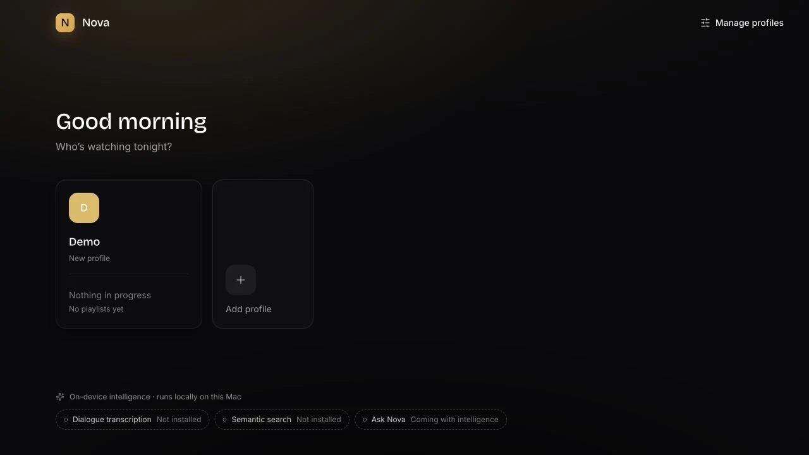
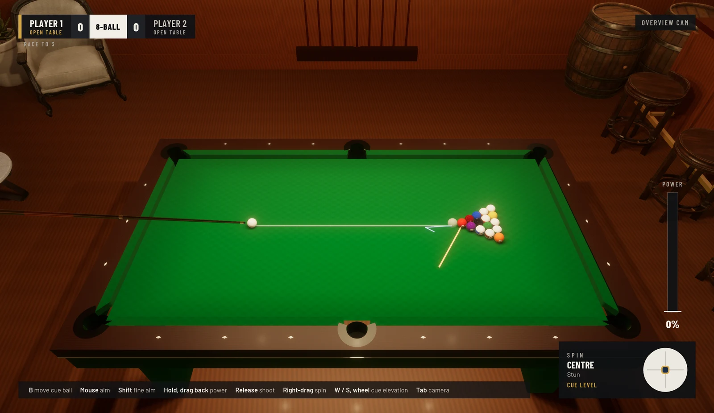
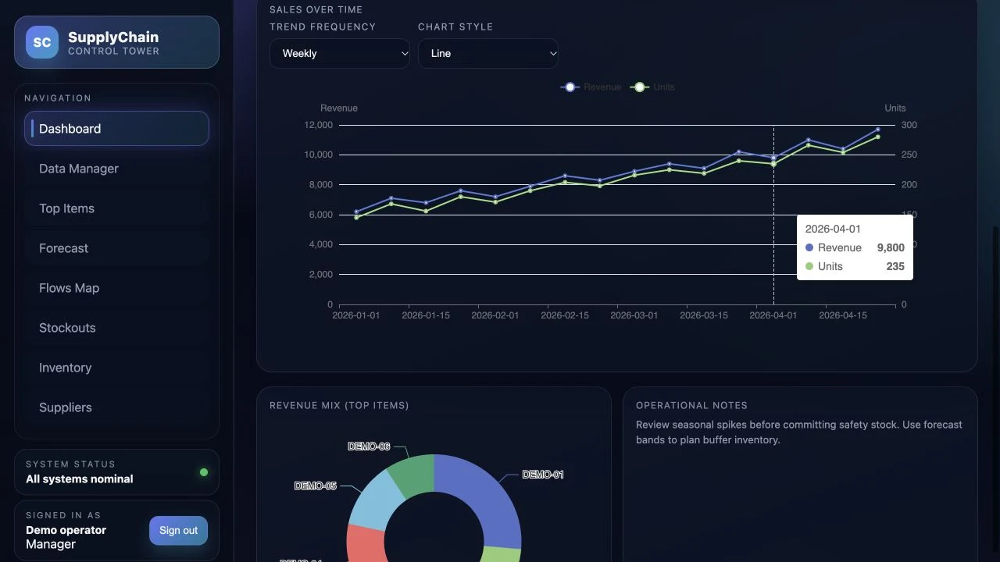

<picture>
  <source media="(prefers-color-scheme: dark)" srcset="./assets/hero-dark.svg">
  <source media="(prefers-color-scheme: light)" srcset="./assets/hero-light.svg">
  
</picture>

**Applied mathematics · Machine learning · Software**

I study applied mathematics and machine learning, and build software to explore how models and systems behave. I'm an **MVA student at ENS Paris-Saclay** and an **engineering student at École des Ponts**, with a background in statistics, optimization and computer science.

  
  <picture>
    <source media="(prefers-color-scheme: dark)" srcset="./assets/schools/ecole-des-ponts-dark.png">
    
  </picture>

At **CERMICS**, I researched optimization in interacting epidemic models, studying vaccination allocations, curvature and Pareto frontiers.

**Seeking a 4–6 month research internship in machine learning, deep learning or NLP.** [Get in touch →](mailto:youssef.sahraoui@enpc.fr)

## Selected work

### [01 / Nova](https://github.com/YoussefSah05/nova)

A native macOS media player for user-supplied playlists, with on-device transcription and optional semantic search. A Rust core manages playback and background workloads, with credentials kept outside the React webview.

Rust · Tauri · React · SQLite · Whisper

UI preview with sample data; native backend and model state are simulated.

### [02 / Billiards Saloon](https://github.com/YoussefSah05/BillardsSaloon-GL)

An event-based billiards simulator and 3D pool game, built in C++20 and OpenGL without a game engine. Headless physics, a rules referee and search-based opponents share the same shot simulation.

C++20 · OpenGL · CMake · doctest

Native gameplay capture from the local desktop build.

### [03 / Supply Chain Control Tower](https://github.com/YoussefSah05/supply-chain-project)

A team-built demand forecasting and inventory application, developed from a Streamlit prototype into a FastAPI and React system. Forecast uncertainty, stockout analysis and supplier scoring support inventory decisions.

Python · FastAPI · React · SQLite

UI preview with synthetic data; displayed figures are illustrative.

## Background & tools

**Programming & tools**

Python · C++ · Linux · Git

**Machine learning & data**

PyTorch · NumPy · Pandas · scikit-learn · Hugging Face

**Mathematical foundations:** Statistics, convex optimization, stochastic processes, machine learning

## Connect

[Email](mailto:youssef.sahraoui@enpc.fr) · [LinkedIn](https://linkedin.com/in/youssef-sahraoui) · [GitHub repositories](https://github.com/YoussefSah05?tab=repositories)
